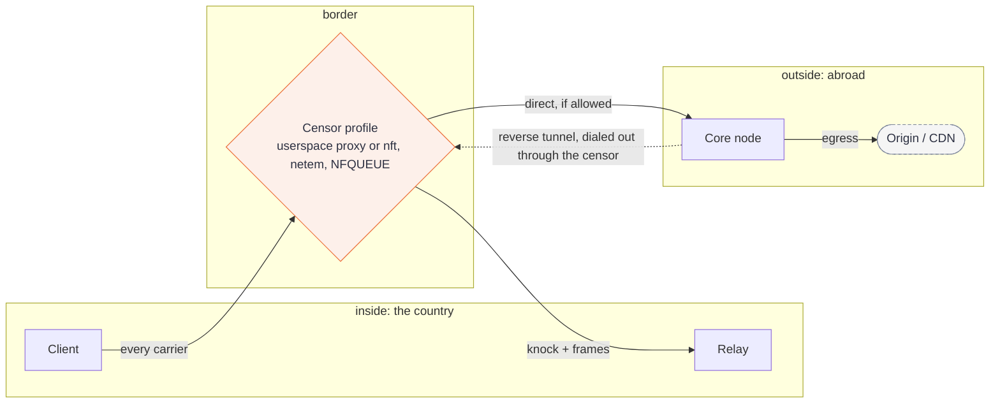

# dotvpn-lab

[](https://github.com/payam-foundation/dotvpn-lab/actions/workflows/ci.yml)
[](#status)
[](LICENSE)

Black-box integration tests for the whole [dotvpn](https://github.com/payam-foundation/dotvpn-wire#related-repositories) stack, plus a lab that models documented censor behaviour and shows which carriers survive it. It builds the real `dotvpn-core` and `dotvpn-relay`, imports `dotvpn-client` and `dotvpn-wire`, and drives them through simulated middleboxes.

## Status

Beta. Userspace suites run anywhere. Packet-level suites need Linux and root (Docker on a Mac). Results are provisional until a few nightly runs set the fingerprint and performance tolerance bands.

## What a green result means

**Lab results check mechanisms, not outcomes.** A green matrix never means "works in Iran" or "works in Russia". Censors differ by ISP, region, mobile versus fixed, and week.

- Every profile rule cites a row in [documented-behaviours.md](docs/lab/documented-behaviours.md): mechanism, source, date, confidence, lab fidelity. No source, no rule.
- Real censor paths, mobile networks and residential lines are not modelled. Lab links are veth pairs.
- Validate with in-country testers or OONI-style probes before claiming anything.

Design: [ADR-016](docs/adr/016-censorship-lab.md).

## The traffic path



The relay sits on the censored side, so the reverse tunnel crosses the censor too. The matrix shows which profiles block it.

## Quick start

All commands run in this repository, with the six dotvpn repositories checked out side by side.

```sh
make test                                           # vet and race tests, userspace suites, any OS
go test -short ./...                                # skip the Snowflake and WebRTC test
make matrix                                         # profile x placement x carrier matrix to out/
make report                                         # diff out/matrix.json against profiles/baseline.json
sudo make lab                                       # packet-level suites: Linux, root, nftables, iproute2, iptables
make lab-docker PKGS="./suites/netns ./suites/leak" # the same from a Mac, with Docker Desktop
sudo make lab-clean                                 # remove namespaces left by an aborted run
```

Useful variables: `LAB_OUT=dir` (results directory), `LAB_UPDATE=1` (rewrite `profiles/baseline.json`; review the diff), `LAB_PERF=1` (throughput suite), `LAB_PREV_DIR` (previous release binaries for the upgrade drill), `LAB_BINS` (prebuilt binaries), `LAB_RUN` (test name filter inside the container).

## What each suite answers

| Suite | Question | Needs |
|---|---|---|
| `functional` | Do carriers, auth, the SSRF guard, the decoy, the reverse relay and replay or probe resistance work with no censor? | nothing |
| `censor` | Does the fallback ladder leave a blocked carrier, and does the stealth path survive a middlebox? | nothing |
| `matrix` | For each profile, placement and carrier, is the verdict `works`, `degraded`, `fails-fast` or `hangs`? Diffed against a committed baseline. | nothing |
| `netns` | Does the same matrix hold when nft and NFQUEUE enforce the rules in network namespaces, including the Iran ICMP rules? | Linux, root, `lab` tag |
| `leak` | With the TUN client and kill switch running and the tunnel or node killed mid-flow, does anything except the tunnel endpoint leave the client (IPv4, IPv6, non-DNS UDP, local resolver)? | Linux, root, `lab` tag |
| `chaos` | Loss, delay, jitter and reorder; core and relay restarts and pool refill; link flaps. | Linux, root, `lab` tag |
| `perf` | Throughput and small-request latency per carrier against a baseline. Nightly. | Linux, root, `lab` tag, `LAB_PERF=1` |
| `fingerprint` | Do the relay and client ClientHellos match current Chrome (JA3, JA4, extension set), and does the decoy's ServerHello match stock nginx? | nothing |
| `deploy` | Do the real relay and core Docker images run hardened, upgrade and roll back over preserved volumes, and keep the production SSRF guard? | Docker |

Default `go test ./...` is userspace only. Anything that needs root, namespaces, nft or tc is behind the `lab` build tag.

## Reading the matrix

Each cell is `profile / placement / carrier`.

- `works`: the fetch succeeded promptly. `degraded`: it succeeded but slowly.
- `fails-fast`: reset or refused. `hangs`: a drop rule, so the dial waits for its timeout. A hang is a product risk even when another carrier wins, because the ladder pays that timeout first.
- The confidence column carries the lowest confidence among the rules that decided the cell. `assumed` means our guess, not a report.
- Any change in either direction fails CI, including a fix. Regenerate with `LAB_UPDATE=1`, read the diff, edit reasons by hand, commit.

How to read the full output and add a profile: [docs/lab/lab.md](docs/lab/lab.md).

## Add a profile

1. Add a row to `documented-behaviours.md` first.
2. Create `profiles/<name>-<yyyy-mm>.json`. Every rule needs an `id`, a `source` and a `confidence`; validation rejects the file otherwise.
3. Register it in the matrix tests, run `make matrix`, review, then `LAB_UPDATE=1`.
4. Record it and the rows you did not encode in `profiles/SOURCES.md`.

Use documentation address ranges (`203.0.113.0/24`, `198.51.100.0/24`, `192.0.2.0/24`) as stand-ins for real ones. A profile older than a few weeks needs its sources re-read before it is trusted.

## Continuous integration

Userspace suites with `-race` run on every push and pull request and gate the matrix baseline. A Linux job runs the `lab` suites with root and uploads JSON and Markdown results. A nightly job adds the performance gate. Component repositories can trigger a lab run on their pull requests; it needs a fine-grained `LAB_DISPATCH_TOKEN` secret with `actions: write` on this repository only, and is skipped without it.

## Documents

- [Architecture](docs/architecture.md): how the six repositories fit together.
- [ADR index](docs/adr/README.md): every decision, across all repositories.
- [Security gate report](docs/REPORT.md): findings, checklist coverage, and what still needs real-world validation.
- [Test deployment report](docs/hetzner-test-report.md): an anonymised run on a real server.
- [Operator guide](docs/operator.md): where to find each operational procedure.

## Related repositories

| Repository | Role |
|---|---|
| [dotvpn-wire](https://github.com/payam-foundation/dotvpn-wire) | Shared wire protocol |
| [dotvpn-core](https://github.com/payam-foundation/dotvpn-core) | Server: node, control plane |
| [dotvpn-relay](https://github.com/payam-foundation/dotvpn-relay) | In-country stealth hop |
| [dotvpn-client](https://github.com/payam-foundation/dotvpn-client) | Client library and `dotvpn` CLI |
| [dotvpn-android](https://github.com/payam-foundation/dotvpn-android) | Android app |

Read [CONTRIBUTING.md](CONTRIBUTING.md) first. Report vulnerabilities as described in [SECURITY.md](SECURITY.md).

## License

[PolyForm Noncommercial License 1.0.0](LICENSE). Source-available, not open source: personal, research, educational and non-profit use is permitted; commercial use needs a separate licence from Payam Foundation.
