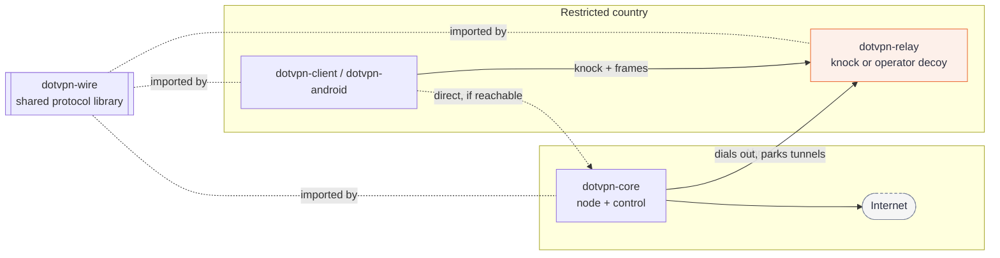

# dotvpn architecture

Six sibling folders. Each is a Go module and an independent git repo, and each keeps its own `docs/`. This file and the cross-repo security report live in `dotvpn-lab`.

| Folder | Kind | Job |
| --- | --- | --- |
| `dotvpn-wire` | library | Frame codec, Ed25519 token/JWT, invite codec, X25519 handshake, Endpoint/Pin, Dialer/Listener seams (tls, cdnws, webtunnel, snowflake, mem), mimic and DNS carriers. Semver + golden vectors. |
| `dotvpn-core` | binary `dotvpn-core` | Server: `node` (edge proxy, decoy, egress/SSRF guard), `admin`/control (accounts, tokens, server list), relay enrollment, reverse listener. Admin is loopback only. |
| `dotvpn-relay` | binary `dotvpn-relay` | In-country stealth hop. Reverse mode, probe-resistant decoy, no logs, no client/admin code. |
| `dotvpn-client` | library + CLI `dotvpn` | Engine, fallback ladder, local SOCKS5/HTTP, TUN, fakedns, router, leak guards (macOS, Windows, Linux). |
| `dotvpn-android` | app | Kotlin/Compose `VpnService` shell around `dotvpn-client/mobile` (gomobile AAR). Invite/QR import, split tunnel, Persian/English. |
| `dotvpn-lab` | lab + tests | Three-component integration, censorship lab (middlebox, netns, active-probe, replay, timing). Formerly `dotvpn-e2e`. |

Dependency rule: core, relay, client and lab depend on `dotvpn-wire` only (plus lab on the other three). `dotvpn-android` consumes `dotvpn-client/mobile` only. Each `go.mod` pins a published wire tag; local side-by-side work uses an untracked `go.work` in the parent directory (see CONTRIBUTING.md).

The relay is installed either from the Docker image or natively with `deploy/install.sh` (stock or `--lowkey`, ADR-016 in `dotvpn-relay`). In both cases it needs an operator-run web server as its decoy.

See `adr/README.md` for the decision index (each ADR lives in the repo that owns it; run and extend the lab via `lab/lab.md`) and each repo's README for install, verify, rollback and development.
